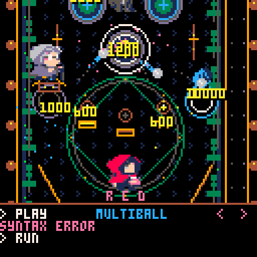
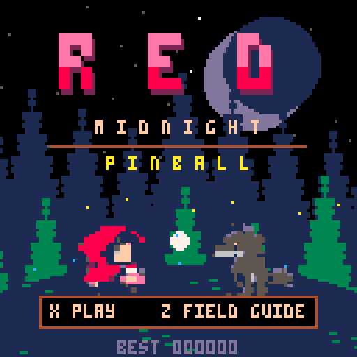
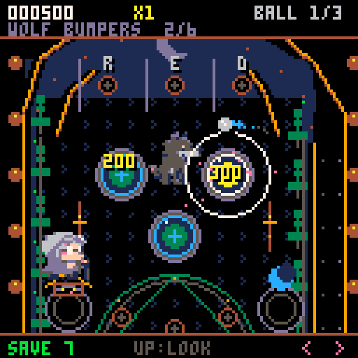
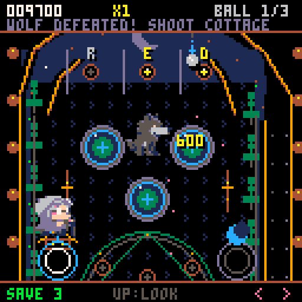
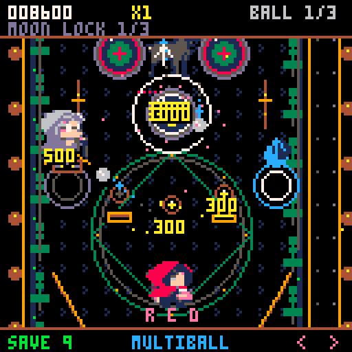

<div align="center">

# RED · Midnight Pinball

**One silver ball. A forest full of trouble.**

A native **PICO-8** pinball adventure with the characters of **RED**.
Defeat the Wolf, rescue Grandmother, and break the Briar Hart before the last ball disappears into the dark.

[**Download v1.0.0**](https://github.com/szabadkai/red-midnight-pinball/releases/tag/v1.0.0) · [**Watch gameplay with sound**](https://github.com/szabadkai/red-midnight-pinball/releases/download/v1.0.0/midnight-gameplay.mp4) · [**Controls**](#controls) · [**Build from source**](#build-from-source)



*Captured in the real PICO-8 runtime. The showcase uses scripted flipper inputs and a staged Hart encounter; ball physics and scoring run live.*

</div>

## A midnight journey, played in pinball

- **A scrolling woodland table.** A 128×224 playfield inside PICO-8's 128×128 display, with brass rails, moonlit lanes, glowing cottage and well scoops, animated characters, silver trails and impact sparks.
- **Three connected character missions.** Six bumper hits defeat the Wolf; the cottage rescues Grandmother; the Briar Hart turns the table into a boss battle. Victory starts a harder journey.
- **Moonlight Multiball.** Three live balls, ball-to-ball collisions, ten seconds of save, and a jackpot at the right moon well. The camera follows the lowest ball; edge arrows track the others.
- **Shots worth learning.** A charged plunger, timed skill shots, independent flippers, catches, nudges, tilt, slingshots, rotating RED lane lights, combos and a 5× multiplier.
- **An original soundtrack.** Eight bars of *Lanterns After Midnight* across three audio channels, with a fourth reserved for eleven synthesized gameplay effects.
- **A complete cartridge.** Three-ball games, persistent best score, in-game field guide, sound toggle and reduced-motion setting. No external game assets are needed at runtime.

## Screenshots

<table>
  <tr>
    <td align="center"><br><strong>Red meets midnight</strong></td>
    <td align="center"><br><strong>The Wolf's bumper garden</strong></td>
  </tr>
  <tr>
    <td align="center"><br><strong>A light in Grandmother's cottage</strong></td>
    <td align="center"><br><strong>Moonlight Multiball</strong></td>
  </tr>
</table>

### Gameplay video

[](https://github.com/szabadkai/red-midnight-pinball/releases/download/v1.0.0/midnight-gameplay.mp4)

**[Watch/download the 14-second MP4 with sound →](https://github.com/szabadkai/red-midnight-pinball/releases/download/v1.0.0/midnight-gameplay.mp4)**

The animated preview plays directly in this README. The MP4 is also included in the release and at [`docs/media/midnight-gameplay.mp4`](docs/media/midnight-gameplay.mp4).

## Play

### Standalone desktop builds

The release also includes self-contained exports; a separate PICO-8 installation is not required to play them.

| Platform | Download |
| --- | --- |
| macOS · Apple Silicon + Intel | [macOS ZIP](https://github.com/szabadkai/red-midnight-pinball/releases/download/v1.0.0/red-midnight-pinball-v1.0.0-osx.zip) |
| Windows | [Windows ZIP](https://github.com/szabadkai/red-midnight-pinball/releases/download/v1.0.0/red-midnight-pinball-v1.0.0-windows.zip) |
| Linux · x86-64 | [Linux ZIP](https://github.com/szabadkai/red-midnight-pinball/releases/download/v1.0.0/red-midnight-pinball-v1.0.0-linux.zip) |
| Raspberry Pi · PICO-8 export | [Raspberry Pi ZIP](https://github.com/szabadkai/red-midnight-pinball/releases/download/v1.0.0/red-midnight-pinball-v1.0.0-raspi.zip) |

Extract the archive and launch the included application. These are official PICO-8 exports. Gameplay validation was performed on macOS and in the browser; Windows, Linux and Raspberry Pi packages have not been manually playtested. [SHA-256 checksums](https://github.com/szabadkai/red-midnight-pinball/releases/download/v1.0.0/SHA256SUMS.txt) accompany every release asset.

### In your browser — no PICO-8 installation required

1. Download **[red-midnight-pinball-v1.0.0-web.zip](https://github.com/szabadkai/red-midnight-pinball/releases/download/v1.0.0/red-midnight-pinball-v1.0.0-web.zip)**.
2. Extract the whole archive and open **`index.html`**.
3. Click the play icon, then press **X** at the title.

Keep `index.html` and `red-midnight.js` together. If your browser restricts local files, serve the extracted directory with `python3 -m http.server 8000` and open `http://localhost:8000`.

### On PICO-8

Download **[red-midnight.p8.png](https://github.com/szabadkai/red-midnight-pinball/releases/download/v1.0.0/red-midnight.p8.png)** and drag it into PICO-8, then type `run`. The PNG is a playable cartridge, not just a cover image.

The editable **[red-midnight.p8](https://github.com/szabadkai/red-midnight-pinball/releases/download/v1.0.0/red-midnight.p8)** contains the same complete game. PICO-8 0.2.6b is the validated native runtime.

### From this repository

With Node.js 20+ and PICO-8 installed:

```sh
git clone https://github.com/szabadkai/red-midnight-pinball.git
cd red-midnight-pinball
npm start
```

No `npm install` is required. You can also double-click **Play Pinball.command** on macOS or **Play Pinball.bat** on Windows. Set `PICO8_BIN` to the executable if it is installed in a nonstandard location.

## Controls

| Key | Action |
| --- | --- |
| **← / →** | Independent flippers; rotate lit RED lane inserts |
| **Hold X or ↓, then release** | Charge and launch; a full charge reaches the upper orbit |
| **Z** | Nudge; three rapid nudges trigger tilt |
| **Hold ↑** | Look at the upper playfield |
| **Esc / Enter** | Pause, field guide, sound, motion and title options |
| **X / Z at the title** | Play / field guide |

**Tip:** release X after starting the game, then hold it again to charge your first shot. Hold a flipper to catch the ball, release it to roll toward the tip, then flip to aim. Nudging can save a drain, but tilt cancels ball save and disables both flippers for four seconds.

## Learn the table

| Objective | How to complete it | Reward |
| --- | --- | --- |
| **Defeat the Wolf** | Hit blue pop bumpers six times | Lights Grandmother's cottage |
| **Rescue Grandmother** | Shoot the glowing left cottage | 5,000 × multiplier and three-ball multiball |
| **Break the Briar Hart** | Hit red bumpers and complete lantern target banks | 15,000 × multiplier and a harder new journey |
| **Light R E D** | Collect all three upper lane lights; flippers shift them | Multiplier increases up to 5×; two sets start multiball |
| **Moonshot** | Collect a RED lane within 2.5 seconds of launch | 2,500 × multiplier skill bonus |
| **Moon locks** | Visit ordinary scoops three times | Multiball |
| **Moonlight jackpot** | Hit the right well with multiple balls active | 5,000 × multiplier |
| **Light the lanterns** | Complete all three amber targets outside the boss phase | Five seconds of ball save |

Each game gives you **three balls**. Launches receive eight seconds of save; multiball and boss victory give ten. A drain spends a turn only when the last unsaved ball leaves the table. Rapid bumper hits build a combo. Best score persists between sessions; scores cap at 3,000,000 to stay within PICO-8's fixed-point range.

## Build from source

| Command | Result |
| --- | --- |
| `npm start` | Play in native PICO-8 |
| `npm run edit` | Open the cartridge in the PICO-8 editor |
| `npm run assemble` | Flatten current Lua and asset data into `red-midnight.p8` |
| `npm run build` | Export `.p8.png` and the official HTML/JS player to `dist/` |
| `npm test` | Run 31 simulation/input checks and cartridge consistency checks; requires Lua |
| `npm run test:native` | Run the checks in actual PICO-8 fixed-point arithmetic |
| `npm run capture` | Record the reproducible native showcase |
| `npm run release:package` | Build the distributable archives and SHA-256 checksums |

The standard test includes a **30,000-frame / 500-second simulation soak**. The native test includes a **1,800-frame / 30-second fixed-point soak**. CI installs Lua and checks the committed cartridge against its editable sources. Native exports and tests require your own PICO-8 installation.

To regenerate the palette-adapted cast, label, score and sound effects, install Python with Pillow and run:

```sh
python3 tools/generate-pinball-assets.py
npm run assemble
```

### Inside the cartridge

```text
src/           Simulation, renderer and input/menu Lua
assets/        PICO-8 cast atlas, label, music and sound data
red-midnight.p8 Self-contained playable source cartridge
sources/       Original character sheets, metadata and Aseprite files
tests/         Shared simulation fixtures and stock-Lua shim
tools/         Assembly, export, asset generation and recording tools
docs/          Playtest notes and screenshots/video
```

Four physics substeps per frame handle capsule contacts and moving flipper surfaces. The static table is painted once into spare RAM at `0x8000–0xbfff`, then scrolled with a framebuffer copy; animation, lights, balls and particles draw afterward. The measured native showcase used `stat(1)` **0.3023 mean / 0.439 peak**, below the **0.5 budget for 60 fps**. This is a measured run, not a guarantee for every host device.

The game fits a single standard cartridge within PICO-8's token and compressed-code limits. See [playtest notes](docs/PLAYTEST.md) for coverage and reproduction steps.

## Credits and rights

Created from the characters and world of [RED — The Gambler's Clearing](https://github.com/szabadkai/red-gamblers-clearing). The original sprite sources are retained, alongside the PICO-8 adaptations. Table artwork, *Lanterns After Midnight*, and the gameplay effects were created for this spin-off.

PICO-8 and its official exported player are by [Lexaloffle Games](https://www.lexaloffle.com/pico-8.php).

See [CREDITS.md](CREDITS.md) and [ASSET_RIGHTS.md](ASSET_RIGHTS.md). Source availability does not grant a blanket license to reuse the character artwork or other assets.
